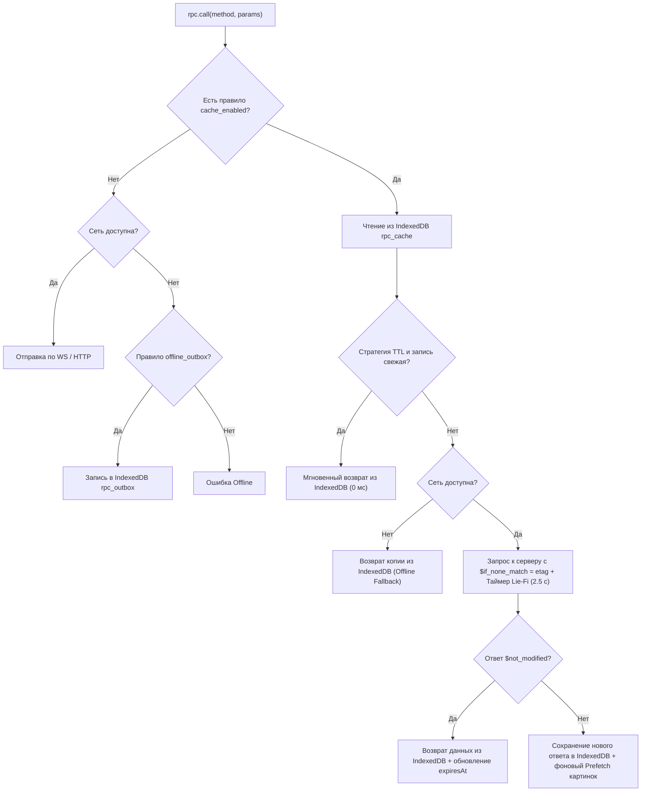

# Глава 5: Автоматическое кеширование, Offline-First и Медиа-кеш (IndexedDB)

В **PyFerro 2.0** подсистема кеширования, экономии трафика, реактивной инвалидации и работы без интернета встроена непосредственно в ядро фреймворка (`RpcRouter`, `CrudEngine`, `AsyncSession`, `Service Worker` и клиентский SDK `rpc.js`).

Главная цель архитектуры — **принцип «Прост снаружи, непрост внутри» (Zero-Boilerplate)**:
* Прикладному программисту (и ИИ-агенту) **не нужно** писать код работы с кешем ни на Python, ни на JavaScript.
* На клиенте все данные (ответы RPC, бинарные изображения `/files/...`, очередь оффлайн-мутаций и системные метаданные) хранятся **исключительно в единой базе `IndexedDB` (`pyferro2_storage`)** без использования `localStorage`.
* Политика кеширования для всех плашек и методов приложения настраивается визуально в **Админ-панели фреймворка** (вкладка **«Кеш и Оффлайн»**) в реальном времени без перезапуска сервера.

---

## 1. Как это выглядит для прикладного разработчика

### 1.1. Бэкенд (Python) — Чистая бизнес-логика

Разработчик пишет обычные методы `@router.rpc_method` и стандартные запросы SQLAlchemy. Никаких декораторов кеша, ручных тегов или проверок версий в коде нет:

```python
class Articles:
    @router.rpc_method(public=True)
    async def get_by_slug(self, db: AsyncSession, slug: str) -> dict:
        row = (await db.execute(select(Article).where(Article.slug == slug))).scalar_one_or_none()
        return row.to_dict() if row else None

    @router.rpc_method
    async def update_article(self, db: AsyncSession, session_data: SessionData, article_id: int, content: str) -> dict:
        article = await db.get(Article, article_id)
        article.content = content
        await db.commit()
        return {"status": "ok"}
```

Всё остальное фреймворк делает сам:
1. По сигнатуре метода (`public=True` и отсутствие `session_data`) понимает, что `Articles.get_by_slug` — публичный (`scope = "public"`).
2. Во время выполнения `SELECT` автоматически фиксирует, что метод читал таблицу `articles`.
3. Когда `Articles.update_article` вызывает `await db.commit()`, хук `AsyncSession` видит изменение таблицы `articles`, автоматически сбрасывает зависимый кеш на сервере и рассылает по WebSocket уведомление клиентам.

### 1.2. Фронтенд (Svelte / JS) — Стандартные вызовы `rpc`

На клиенте разработчик вызывает стандартные методы `rpc.call()`, `rpc.stream()` и `createPaginator()`:

```js
// Разовый запрос (данные мгновенно берутся из IndexedDB или сети)
const catalog = await rpc.call("Calculator.get_catalog");

// Реактивный поток:
// 1-й yield (0-2 мс) -> из IndexedDB (даже без интернета)
// 2-й yield -> после сверки $etag с сервером (если данные изменились)
// 3-й+ yield -> при получении push-сигнала об изменении таблицы на сервере
for await (const article of rpc.stream("Articles.get_by_slug", { slug: "pepper_guide" })) {
    currentArticle = article;
}
```

Картинки внутри статьи (``) также не требуют спец-компонентов: они автоматически предзагружаются в `IndexedDB` при получении статьи и мгновенно отдаются Service Worker'ом из `IndexedDB` в оффлайне.

---

## 2. Управление кешированием в Админке (`CacheView.svelte`)

Встроенная админ-панель PyFerro 2.0 содержит вкладку **«Кеш и Оффлайн»**, доступную главным администраторам и ролям с правом `admin.cache`.

### 2.1. Глобальные настройки (`pf_cache_config`)

| Поле | Тип | По умолчанию | Описание |
| :--- | :--- | :--- | :--- |
| `enabled` | `bool` | `True` | Глобальный рубильник подсистемы кеширования и оффлайна. |
| `liefi_timeout_ms` | `int` | `2500` | Таймаут «плохого интернета» (мс). Если сеть не отвечает за это время, клиент мгновенно отдает копию из `IndexedDB`. |
| `max_media_mb` | `int` | `250` | Лимит хранилища медиафайлов (`files_cache`) в `IndexedDB` на клиенте (МБ). При превышении старые файлы вытесняются по LRU. |
| `max_rpc_entries` | `int` | `2000` | Максимальное число ответов RPC в `rpc_cache` `IndexedDB` клиента. |
| `cache_epoch` | `int` | `1` | Номер эпохи кеша. Нажатие кнопки **«Сбросить весь кеш»** увеличивает `cache_epoch`, заставляя сервер и всех клиентов очистить накопленный кеш. |

### 2.2. Правила для методов по Плашкам (`pf_cache_rules`)

Для каждого метода из `router.business_methods()` и `crud.models()` в таблице правил настраиваются:

| Поле | Тип | По умолчанию | Описание |
| :--- | :--- | :--- | :--- |
| `method_name` | `str` (PK) | — | Полное имя метода (`Calculator.get_catalog`, `Articles.get_by_slug`). |
| `cache_enabled` | `bool` | `False` | Включает серверное и клиентское (`IndexedDB`) кеширование ответа. |
| `strategy` | `str` | `"auto"` | `"auto"` (мгновенно из `IndexedDB` + фоновая сверка по `$etag`) или `"ttl"` (строгое кеширование на `ttl_sec` без сетевых запросов). |
| `ttl_sec` | `int` | `300` | Время жизни в секундах (для стратегии `"ttl"`). |
| `prefetch_media` | `bool` | `False` | Автоматически находить в ответе все ссылки `/files/...` и `/images/...` и скачивать их в `IndexedDB` (`files_cache`). |
| `preload_on_boot` | `bool` | `False` | Для методов без обязательных аргументов: автоматически вызывать и кешировать метод в фоне при первом запуске приложения. |
| `offline_outbox` | `bool` | `False` | Для методов записи: при вызове без сети сохранять вызов в очередь `rpc_outbox` в `IndexedDB` с досылкой при подключении. |

### 2.3. Системные RPC-методы управления (`cache.*`)
* `cache.get_settings()` — возвращает глобальный конфиг, список всех бизнес-методов с их текущими правилами и статистику серверного L1-кеша (число записей в RAM, hit/miss ratio).
* `cache.save_settings(config, rules)` — атомарно сохраняет настройки в БД, обновляет in-memory таблицу правил в `RpcRouter` и рассылает подключенным клиентам обновленный манифест правил `$cache.config_updated`.
* `cache.purge_all()` — очищает серверный RAM-кеш, инкрементирует `cache_epoch` и рассылает сигнал `$cache.purge` всем клиентам.

---

## 3. Архитектура серверного движка (`src/pyferro2/cache/`)

### 3.1. Статический анализ Scope (`public` vs `user`)
При компиляции `RpcMethodSpec` фреймворк автоматически вычисляет область видимости:
* Если `spec.public is True` и `spec.session_data_arg is None` и `spec.session_arg is None` $\rightarrow$ **`scope = "public"`**. Ключ в серверном кеше: `(method_name, canonical_params_json)`.
* Во всех остальных случаях $\rightarrow$ **`scope = "user"`**. Ключ изолирован по `session_data.user_id`.

### 3.2. Авто-трекинг таблиц SQLAlchemy (`db/engine.py`)
В `DatabaseEngine` регистрируются два легковесных слушателя событий SQLAlchemy:
1. **`do_orm_execute(orm_execute_state)`:**
   Если `orm_execute_state.is_select` и в `contextvars` активен контекст кешируемого RPC-вызова (`_active_table_tracker`), из объекта `statement.froms` извлекаются имена всех таблиц (`table.name`) и добавляются в `set[str]` текущего вызова.
2. **`after_flush(session, flush_context)` и `after_commit(session)`:**
   При изменении любых объектов (`session.new`, `session.dirty`, `session.deleted`) их имена таблиц (`obj.__tablename__`) накапливаются в `session.info["_mutated_tables"]`.
   Сразу после успешного `commit()` вызывается `cache_manager.invalidate_by_tables(mutated_tables)`:
   * Из серверного RAM-кеша удаляются все записи, зависящие от этих таблиц.
   * Вычисляется список затронутых `method_name`, и всем активным WebSocket-клиентам отправляется фрейм:
     ```json
     {"jsonrpc": "2.0", "method": "$cache.invalidate", "params": {"methods": ["Articles.get_by_slug", "Articles.list"]}}
     ```

### 3.3. Протокол ETag (`$if_none_match` и `$not_modified`)
1. При сериализации ответа кешируемого метода вычисляется быстрый 64-битный дайджест `hashlib.blake2b(payload_bytes, digest_size=8).hexdigest()`.
2. В пакет ответа добавляется блок метаданных:
   ```json
   {
     "jsonrpc": "2.0",
     "id": 7,
     "result": { ... },
     "$cache": {
       "etag": "9f86d081884c7d65",
       "scope": "public",
       "strategy": "auto",
       "ttl": 300,
       "prefetch_media": true,
       "epoch": 1
     }
   }
   ```
3. Если клиент во входящем JSON-RPC запросе передал поле `"$if_none_match": "9f86d081884c7d65"`, и в серверном кеше для этого ключа актуальный `etag` совпадает — сервер **не вызывает Python-хендлер, не ходит в БД и не пересылает массив данных**, а мгновенно возвращает:
   ```json
   {
     "jsonrpc": "2.0",
     "id": 7,
     "result": { "$not_modified": true },
     "$cache": { "etag": "9f86d081884c7d65", "epoch": 1 }
   }
   ```

### 3.4. Защита от дублей для Offline Outbox (`$idempotency_key`)
Когда клиент отправляет мутацию из оффлайн-очереди (или при нестабильной сети), он передает в пакете `"$idempotency_key": "<uuid>"`.
Серверный `RpcRouter` хранит в RAM кольцевой буфер последних `2000` ключей идемпотентности (с TTL 15 минут). Если запрос с тем же `$idempotency_key` приходит повторно из-за обрыва связи, сервер возвращает сохраненный результат первого выполнения без повторного запуска метода.

---

## 4. Архитектура клиентского движка (`IndexedDB` `pyferro2_storage`)

На клиенте вся работа с хранилищем сосредоточена в модуле `idbStorage` внутри `rpc.js` / `rpc.ts` и разделяется с `service-worker.ts`.

### 4.1. Схема базы `IndexedDB` (`pyferro2_storage`, version `1`)

1. **`sys_meta`** (`keyPath: "key"`):
   * `"auth_token"` — JWT-токен сессии (синхронизируется с оперативной переменной в `rpc.js` при старте).
   * `"cache_manifest"` — полученная от сервера в `system.get_public_config` конфигурация (`enabled`, `liefi_timeout_ms`, `max_media_mb`, `cache_epoch`, `rules`).
2. **`rpc_cache`** (`keyPath: "cacheKey"`, индексы: `by_method`, `by_scope`, `by_updated_at`):
   * `cacheKey`: строка `"${scope}:${userId || 0}:${method}:${canonicalParams}"`
   * `method`: имя метода (`"Articles.get_by_slug"`)
   * `data`: распакованный JS-объект ответа (хранится через нативный *Structured Clone* без `JSON.stringify`)
   * `etag`: строка хеша (`"9f86d081884c7d65"`)
   * `scope`: `"public"` | `"user"`
   * `expiresAt`: timestamp истечения TTL
   * `updatedAt`: timestamp последнего обращения (для LRU-очистки)
3. **`files_cache`** (`keyPath: "url"`, индекс: `by_last_accessed`):
   * `url`: относительный путь (`"/files/n4BvxHTRD7DZ/1.webp"`)
   * `blob`: бинарный объект `Blob` изображения/файла
   * `mimeType`: `"image/webp"`, `"image/svg+xml"` и т.д.
   * `sizeBytes`: размер в байтах
   * `lastAccessed`: timestamp последнего чтения
4. **`rpc_outbox`** (`keyPath: "id"`, `autoIncrement: true`):
   * `idempotencyKey`: UUID v4
   * `method`: имя вызываемого метода
   * `params`: аргументы вызова
   * `createdAt`: timestamp постановки в очередь

### 4.2. Алгоритм работы `rpc.call(method, params, options)`



### 4.3. Кеширование и раздача картинок (`Media Prefetcher` + `Service Worker`)

1. **Извлечение ссылок из данных (`Media Prefetcher`):**
   Когда метод имеет флаг `prefetch_media: true`, после получения ответа функция `extractMediaUrls(data)` обходит поля объекта (включая Markdown-текст статей и постов форума) и находит все вхождения:
   * `/files/[A-Za-z0-9_-]+/[^\s"')>]+`
   * `/images/[^\s"')>]+`
2. **Фоновая закачка в `IndexedDB` (`files_cache`):**
   Для каждого найденного URL проверяется наличие ключа в `files_cache`. Если файла еще нет, он скачивается через `fetch(url)`, преобразуется в `Blob` и сохраняется в `IndexedDB`. При превышении `max_media_mb` самые старые записи по индексу `by_last_accessed` автоматически удаляются.
3. **Мгновенный перехват в `service-worker.ts`:**
   Когда браузер запрашивает любую картинку `/files/...` или `/images/...`:
   * Service Worker открывает `IndexedDB` (`pyferro2_storage` $\rightarrow$ `files_cache`).
   * Если `Blob` есть в `files_cache` — мгновенно возвращает `new Response(record.blob, { status: 200, headers: { "Content-Type": record.mimeType, "Cache-Control": "max-age=31536000" } })`.
   * Если `Blob` отсутствует — загружает из сети, кладет копию в `files_cache` в `IndexedDB` и возвращает ответ браузеру.
   * Благодаря этому статьи, каталог культур, форум и дневники открываются в полном оффлайне со всеми фотографиями и иллюстрациями.
