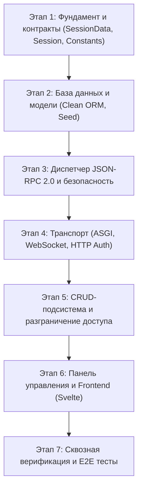

# 🚀 Дорожная карта реализации PyFerro 2.0: Архитектурный план

> **Главный принцип**: Никакого груза обратной совместимости. Поэтапная, изолированная реализация в `pyferro2/`. Строгие типы, единые имена (без синонимов), ноль защитного спама (`defensive clutter`).

---

## 🏛️ 1. Архитектурные принципы PyFerro 2.0

```
┌────────────────────────────────────────────────────────────────────────┐
│                        PyFerro 2.0 Core Stack                          │
├────────────────────────────────┬───────────────────────────────────────┤
│ 1. SessionData & Session Contract │ user_id (int|None), username (str),   │
│                                   │ roles & permissions (frozenset[str])  │
├────────────────────────────────┼───────────────────────────────────────┤
│ 2. Data Models (Clean DB)      │ pf_auth_user, pf_auth_role            │
│                                │ is_system=True для системных ролей    │
├────────────────────────────────┼───────────────────────────────────────┤
│ 3. Transport & Protocol        │ JSON-RPC 2.0 over WebSocket & HTTP    │
│                                │ ferro_session / Bearer token          │
├────────────────────────────────┼───────────────────────────────────────┤
│ 4. Access Control (RBAC)       │ Data Plane (права на модели/RPC)      │
│                                │ Control Plane (adm_* скоупы админки)  │
├────────────────────────────────┼───────────────────────────────────────┤
│ 5. CRUD Engine & Admin UI      │ Декларативные схемы, чистый Svelte UI │
└────────────────────────────────┴───────────────────────────────────────┘
```

### Золотые правила чистоты:
1. **База данных с чистого листа**:
   * Никакого переноса старых баз или файлов (`app.db`).
   * Новая чистая БД: `pyferro2.db`.
   * Лаконичные DDL-схемы без многолетних наслоений, неиспользуемых колонок и индексов.
2. **Никаких синонимов и дублирования флагов**:
   * Только `user_id` (никаких `uid`, `id`, `sub`).
   * Только `username` (никаких `login`, `user_name`, `name`).
   * Только `roles: frozenset[str]` (никакого поля `role` в единственном числе).
   * **Единый источник правды для админа**: наличие системной роли `"admin"` в `roles`. В таблице `pf_auth_user` **нет** никаких дублирующих колонок `is_admin` или `is_superadmin`. Назначение админа = добавление связи с ролью `"admin"`.
3. **Никаких текстовых списков через запятую**:
   * Системные скоупы `adm_*` — это полноценные записи в таблице `pf_auth_role` с флагом `is_system=True`. Поле `user.admin_roles` уничтожается.
4. **Единый транспорт**:
   * Один токен, одно имя куки (`ferro_session`), один заголовок (`Authorization: Bearer <token>`).
5. **Строгий Fail-Fast**:
   * Никаких 5-этажных цепочек `getattr(...) or getattr(...)`. Если объект не соответствует контракту — исключение на входе.

---

### ⚡ Закон минимального потребления CPU и Zero-Boilerplate:

1. **Zero-Reflection в рантайме (Инспекция ровно 1 раз при старте)**:
   * Модуль `inspect` (`inspect.signature`) вызывается строго в момент регистрации функции (`@rpc_method`).
   * Компилируется легковесный `CallSpec` (готовые индексы аргументов). Во время боевого вызова — прямой проброс без рефлексии.
2. **Нулевой Boilerplate для разработчика (Smart Dependency Injection)**:
   * Обработчик RPC запрашивает только то, что нужно: `session_data: SessionData` (паспортные данные) или `session: Session` (канал связи, если нужны `notify` на фронт), `db: AsyncSession`, `a: int`.
   * Никакого ручного извлечения из словарей `params.get(...)`, никакого ручного заворачивания в `{"jsonrpc": "2.0", "result": ...}`.
3. **Ленивая база данных (Lazy DB Injection)**:
   * Сессия БД из пула запрашивается **только** если в сигнатуре метода явно объявлен аргумент `db: AsyncSession`.
   * Запросы вроде `ping`, проверки статуса и кэшированные RPC не тратят ни одного такта CPU на транзакции и пул БД.
4. **Сверхбыстрая сериализация (orjson)**:
   * На парсинг и сериализацию пакетов ставится Rust-парсер `orjson`. Отдает готовые `bytes` прямо в ASGI/сокетовод без промежуточных копий строк в памяти.
5. **`slots=True` на всех внутренних сущностях**:
   * Все структуры (`SessionData`, `Session`, `RpcRequest`) имеют строгие `__slots__` (минус 60% памяти, ноль мусора для Garbage Collector).
6. **Прямой dispatch O(1) и in-memory кэш разрешений**:
   * Все разрешения из БД (RPC-методы и операции CRUD) загружаются **ровно 1 раз при логине** (или инициализации гостя) в единый неизменяемый `permissions: frozenset[str]` внутри `SessionData`.
   * Проверка роли и разрешения: мгновенный C-уровневый поиск в `frozenset` (~15 нс, переиспользование уже посчитанного хэша строки `PyASCIIObject.hash`, 0 аллокаций в рантайме, 0 запросов в БД при вызовах RPC).
   * Для CRUD-моделей константные строки прав (`"Model:create"`, `"Model:read"`, `"Model:update"`, `"Model:delete"`) предвычисляются 1 раз при старте сервера в момент регистрации модели.
   * Глубокая иммутабельность `SessionData` позволяет безопасно шарить один и тот же экземпляр `frozenset` между тысячами гостевых или типовых сессий (0 лишних байт RAM).
   * Поиск метода: плоский C-хеш-словарь `methods[method_name]`.

---

## 🗺️ 2. Поэтапный план реализации



---

### Этап 1: Фундамент и строгие контракты (`pyferro2/core/`)
**Цель**: Создать типизированный базис, от которого зависят все остальные модули.

* **1.1. `constants.py`**:
  * Перечисление `admRole` (административные роли и скоупы):
    `admin = "admin"`, `adm_crud = "adm_crud"`, `adm_users = "adm_users"`, `adm_roles = "adm_roles"`, `adm_settings = "adm_settings"`, `adm_rpc = "adm_rpc"`, `adm_help = "adm_help"`, `adm_seo = "adm_seo"`.
  * Базовые роли БД: `GUEST_ROLE = "guest"`, `USER_ROLE = "user"`.
  * Наборы: `SYSTEM_ROLES = frozenset(...)`, `ADM_SECTION_ROLES = frozenset(...)`.
  * Стандартные коды ошибок JSON-RPC 2.0 и коды закрытия WS.
* **1.2. `session_data.py`**:
  * Датакласс `SessionData` (100% глубокая иммутабельность, `slots=True`):
    ```python
    @dataclass(frozen=True, slots=True)
    class SessionData:
        user_id: int | None
        username: str
        roles: frozenset[str]
        permissions: frozenset[str] = frozenset()

        @property
        def is_admin(self) -> bool:
            return "admin" in self.roles

        @property
        def is_guest(self) -> bool:
            return self.user_id is None

        def has_role(self, role: str) -> bool:
            return role in self.roles

        def has_permission(self, permission: str) -> bool:
            return self.is_admin or permission in self.permissions

        def has_admin_access(self, section: str) -> bool:
            return self.is_admin or f"adm_{section}" in self.roles
    ```
* **1.3. `session.py`**:
  * Контракт сессии WebSocket и HTTP-контекста (`Session`):
    * Содержит данные текущего пользователя: `data: SessionData`.
    * Предоставляет высокоуровневый канал отправки на фронт: `await session.notify(event, data)` (прогресс долгих задач, стриминг, события клиенту в реальном времени).
    * Инкапсулирует транспорт: никакого проброса сырых сокетов, байтов и сетевых буферов в бизнес-логику.
* **1.4. Модульные тесты 1-го этапа**: 100% покрытие контрактов.

---

### Этап 2: База данных и чистые модели (`pyferro2/db/`, `pyferro2/auth/`)
**Цель**: Спроектировать лаконичную схему БД без устаревших колонок и костылей.

* **2.1. Базовые классы ORM (`pyferro2/db/`)**:
  * `Base` — чистый асинхронный SQLAlchemy 2.0 `DeclarativeBase` с первичным ключом `id: int` (для системных и обычных таблиц без лишних колонок).
  * `RowSecureModel(Base)` — абстрактная модель для таблиц, где требуется построчное владение записью (`creator_id`, `created_at`, `updated_at`; без преждевременных `team_id` и дублирующего `owner_id`).
  * `Database` — понятная обертка над асинхронным движком и фабрикой сессий (`pyferro2.db`).
* **2.2. Модель `Role` (`pf_auth_role`) и `RolePermission` (`pf_auth_role_permission`)**:
  * Чистый RBAC (права назначаются строго ролям, никаких обходных пользовательских таблиц прав).
  * `Role`: `id: int` (PK), `name: str` (unique), `description: str`, `is_system: bool = False` (жесткая защита на уровне ORM от удаления и переименования).
  * `RolePermission`: единая прозрачная таблица (`id`, `role_id`, `permission: str`), хранящая строки разрешений 1-в-1 как в `SessionData.permissions` (`"catalog.get_items"`, `"Article:read"`).
* **2.3. Модель `User` (`pf_auth_user`)**:
  * `id: int` (PK), `username: str` (unique, indexed), `password_hash: str` (stdlib `hashlib.scrypt`), `email: str | None`, `full_name: str`, `is_active: bool = True`.
  * Связь M2M `roles` (через `pf_auth_user_role`).
  * Метод `user.to_session_data() -> SessionData` — собирает иммутабельный паспорт сессии за один шаг.
  * *Удалено без следа*: `login`, `admin_roles`, `is_admin`, дубли ФИО.
* **2.4. Автоматический сидинг (Boot Seeder)**:
  * Гарантированное идемпотентное создание при старте:
    * Системные роли: `guest`, `user`, `admin`, `adm_*` (`is_system=True`).
    * Создание базового администратора с привязанной ролью `admin`.
* **2.5. Модульные тесты 2-го этапа**: создание таблиц, сидинг, связка user-role, сборка `SessionData`, защита `is_system` от удаления и смены имени.

---

### Этап 3: Диспетчер JSON-RPC 2.0 и авторизация RPC (`pyferro2/rpc/`)
**Цель**: Скоростной, строгий RPC-роутер с явным разграничением системных и бизнес-методов.

* **3.1. Универсальный декоратор `@rpc_method`**:
  * **Публичные методы (открыты всем без настройки в БД, например `auth.login`, `system.ping`)**:
    ```python
    @rpc_method(public=True)
    async def ping() -> str: ...
    ```
  * **Бизнес-методы (права настраиваются в БД и проверяются в памяти по `session_data.permissions`)**:
    ```python
    @rpc_method
    async def get_items(session_data: SessionData, ...): ...
    ```
    *(Имя метода вычисляется автоматически по имени модуля и функции: `catalog.get_items`, либо задается явно `name="..."`)*
  * **Системные / административные методы**:
    ```python
    @rpc_method(role=[admRole.adm_crud, admRole.admin])
    async def update_schema(session_data: SessionData, ...): ...
    ```
    *(Явный список ролей из перечисления `admRole`, которым разрешен прямой вызов)*
* **3.2. Прозрачная проверка доступа (`check_rpc_access`, O(1) в памяти)**:
  1. **Публичный метод или Администратор платформы**: `if method.public or session_data.is_admin: return True`.
  2. **Системный метод (указан `role=[...]`)**: доступ разрешен, если `not session_data.roles.isdisjoint(method.required_roles)`.
  3. **Бизнес-метод (без явного `role`)**: мгновенная in-memory проверка `method.name in session_data.permissions` (0 обращений к БД при вызове RPC).
* **3.3. Нативный Multi-Return (`async def ... yield`)**:
  * Обычные обработчики (`async def ... return`) выполняются атомарно.
  * Стриминговые обработчики (`async def ... yield`, определяется один раз при регистрации через `inspect.isasyncgenfunction`) отправляют промежуточные результаты через `{"jsonrpc": "2.0", "id": req_id, "result": item, "stream": true}` и завершаются финальным пакетом `{"jsonrpc": "2.0", "id": req_id, "result": null, "done": true}`.
* **3.4. Стандартизация ошибок JSON-RPC 2.0**:
  * `UnauthorizedError (-32001)` — требуется авторизация.
  * `ForbiddenError (-32003)` — недостаточно прав.
  * `MethodNotFoundError (-32601)` — метод не зарегистрирован.
  * `InvalidParamsError (-32602)` — ошибка валидации параметров.
* **3.5. Тесты 3-го этапа**:
  * Вызовы системных методов пользователями с/без `adm_*`.
  * Вызовы бизнес-методов гостем и зарегистрированным пользователем по матрице БД, а также потоковый `yield` (multi-return).

---

### Этап 4: Сервер, Аутентификация и Файловое ядро (`pyferro2/server/`, `pyferro2/files/`)
**Цель**: Чистый ASGI-сервер, гибридный JWT-менеджер (совместимый с Nginx), живые сессии WebSocket/HTTP и встроенная двухфазная файловая подсистема.

* **4.1. Гибридный менеджер токенов (`TokenManager` в `pyferro2/server/tokens.py`)**:
  * Токен — стандартный JWT (`HS256`), который понимает Nginx (`auth_jwt` / `X-Accel-Redirect`).
  * Внутри Python работает мгновенный O(1) in-memory кэш (`jwt_str -> SessionData`), отдающий паспорт сессии за ~20 нс без повторного крипто-декодирования и без запросов к БД.
  * Выпуск и проверка целевых JWT-токенов для скачивания приватных файлов (`issue_file_token` / `verify_file_token`).
* **4.2. Системные RPC-методы сессии (`pyferro2/server/auth_rpc.py`)**:
  * `system.ping`, `auth.login`, `auth.logout`, `auth.me`.
* **4.3. Чистый ASGI-сервер (`PyFerroApp` в `pyferro2/server/app.py`)**:
  * Извлечение токена: сначала заголовок `Authorization: Bearer <t>`, затем кука `ferro_session`, затем query `?token=<t>`.
  * Привязка `scope["session_data"] = session_data`.
  * `WebSocket /ws`: конкурентная обработка JSON-RPC 2.0 и стримов (`yield`), отправка уведомлений `session.notify`, смена `session_data` на лету при `auth.login`/`auth.logout`.
  * **Graceful Disconnect при смене прав (`app.disconnect_user(user_id)`)**: при изменении ролей или прав пользователя сервер отзывает его токены и закрывает активные WS-соединения (обычные короткие RPC-вызовы `return` штатно завершаются перед закрытием сокета, а бесконечные подписки `yield` мгновенно прерываются через `aclose()`).
  * `HTTP POST /rpc`: синхронный вызов JSON-RPC 2.0 по HTTP.
  * Потоковые файловые HTTP-маршруты: `POST /upload` (стриминг чанками на диск за O(1) RAM с расчетом SHA-256) и `GET /files/<folder>/<filename>` (с поддержкой `X-Accel-Redirect` для Nginx).
* **4.4. Файловая подсистема ядра (`pyferro2/files/`)**:
  * Модель `StoredFile(RowSecureModel)` (`pf_file_metadata` с единым `id` и `creator_id`).
  * Координатор двухфазной загрузки `FileStorage` (`init_upload` -> потоковая закачка -> атомарный `commit` за 0 мс через `os.replace` или `rollback`).
  * RPC-методы: `files.init_upload`, `files.commit`, `files.rollback`, `files.list_my`, `files.delete`, `files.get_download_token`.
* **4.5. Тесты 4-го этапа**: авторизация по куке и Bearer, вход через WS, проверка отсечения невалидных/отозванных JWT, двухфазная загрузка и раздача файлов (включая `X-Accel-Redirect`).

---

### Этап 5: Декларативный движок CRUD, RLS и единая модель `Плашка.метод` (`pyferro2/crud/`)
**Цель**: Единая модель методов для таблиц и кастомных RPC без разделения сущностей (3 файла: `spec.py`, `engine.py`, `rpc.py`), с O(1) проверкой прав (`Плашка.метод` / `Плашка.метод_own`) и защитой системных записей.

* **5.1. Однократная интроспекция при старте (`ModelSpec` в `pyferro2/crud/spec.py`)**:
  * Чтение `sqlalchemy.inspect(model)` и опционального вложенного `class Crud:` (`title`, `searchable`, `readonly`, `hidden`) строго один раз при `crud.register(Model)`.
  * Каждая модель автоматически регистрирует 4 точечных метода в роутере: `Model.create`, `Model.read`, `Model.update`, `Model.delete`.
* **5.2. Исполнитель запросов и RLS (`CrudEngine` в `pyferro2/crud/engine.py`)**:
  * Единый допуск в роутере и движке: метод `X.y` доступен при наличии в `session_data.permissions` либо `X.y` («Разрешено»), либо `X.y_own` («Только свои»).
  * Автоматический Row-Level Security (`*_own`): для моделей с `creator_id` (`RowSecureModel`) при праве `*_own` автоматически добавляется SQL-фильтр `WHERE creator_id = session_data.user_id`. Если у метода или модели нет `creator_id` (например `create` или кастомный RPC), включенная галочка `*_own` спокойно работает без падений.
* **5.3. RPC-методы схемы и управления RBAC (`pyferro2/crud/rpc.py`)**:
  * `crud.schemas` — отдает описание полей зарегистрированных моделей.
  * `admin.get_permissions_matrix`, `admin.set_role_permissions`, `admin.set_user_roles`, `admin.create_user` (с защитой `is_system=True` и автоматическим `disconnect_user` при изменении ролей/прав).
* **5.4. Тесты 5-го этапа**: операции `Model.create / read / update / delete`, кастомные `Book.transfer / Book.archive`, фильтрация и защита чужих записей по RLS (`*_own`), блокировка удаления системных ролей, мультиретурн (`yield`) и мягкий дисконнект.

---

### Этап 6: Интерфейс панели управления (`pyferro2/frontend/`, маршрут `/pyferro_admin`)
**Цель**: Легкий, лаконичный SPA на Svelte 5 без легаси-проверок, изолированный на `/pyferro_admin` (маршрут `/admin` остается полностью свободным для клиентских приложений).

* **6.1. Состояние сессии (`authState` в `auth.svelte.js`) и входной барьер**:
  * Хранит строго: `{ userId, username, roles, isAdmin }`.
  * Вход в `/pyferro_admin` разрешен только при наличии роли `admin` или хотя бы одной роли `adm_*`.
* **6.2. Плашки прав (`Плашка.метод`) с двумя чекбоксами**:
  * Фронтенд автоматически группирует все методы (`Article.create`, `Article.read`, `Book.transfer`, `Book.archive`, `files.*`) по префиксу до точки в карточки-плашки и рисует для каждой строки два чекбокса: **«Разрешено»** и **«Только свои»**.
* **6.3. Экран пользователей, ролей и таблиц (CRUD)**:
  * Чекбоксы ролей (системные роли помечены бейджем `[Системная]`), динамический табличный редактор по `crud.schemas`.
* **6.4. Сборка и интеграция**:
  * Статическая сборка (`pyferro2/frontend/dist`), раздача через HTTP-эндпоинт `/pyferro_admin`.
---

### Этап 7: Сквозное тестирование и документация (`pyferro2/tests/`)
**Цель**: Полная уверенность в надежности и чистоте системы.

* **7.1. Интеграционные тесты полного цикла**:
  * Старт сервера -> Подключение гостя -> Регистрация -> Логин -> Получение прав -> Вход в админку -> Вызовы CRUD -> Выход.
* **7.2. Архитектурная документация**:
  * Диаграммы взаимодействия, руководство по созданию плагинов/моделей.

---

## 🎯 Результат выполнения плана:
* Полная изоляция от легаси-кода (старый PyFerro продолжает работать параллельно, пока `PyFerro2` строится).
* Абсолютный ноль «мусорных» полей и синонимов.
* Каждый этап сдается с набором чистых тестов.
